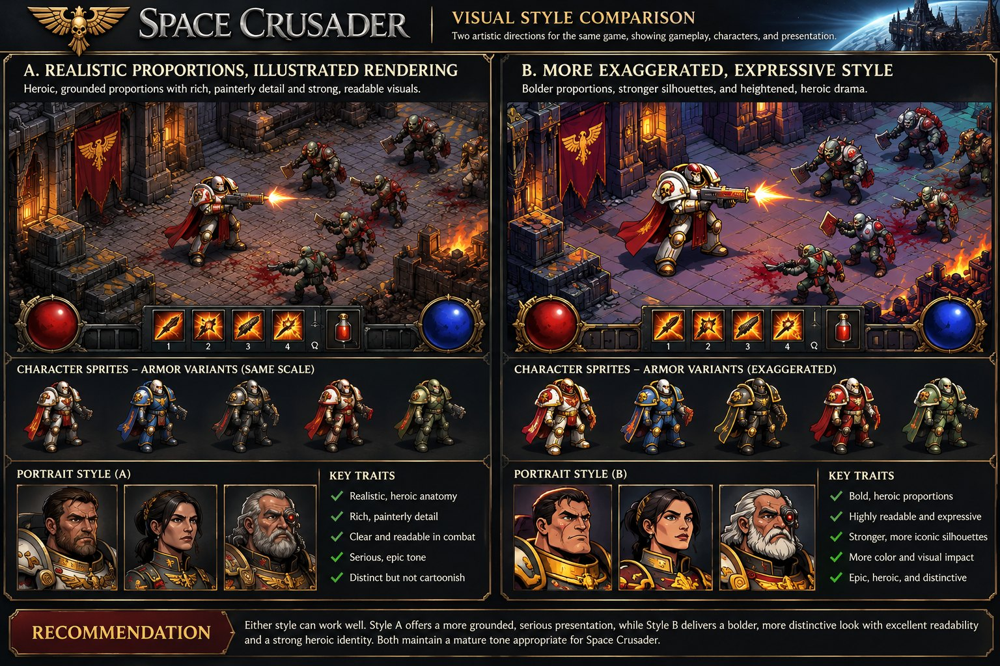
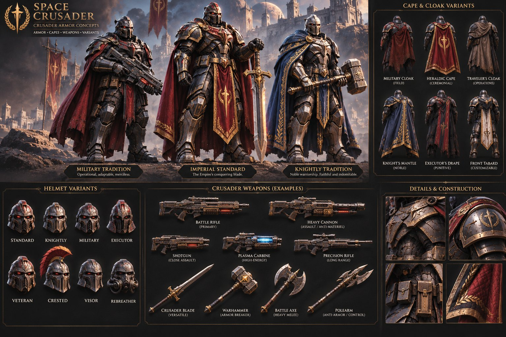
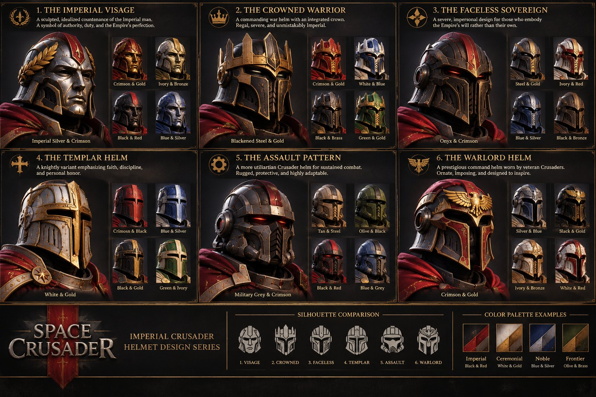
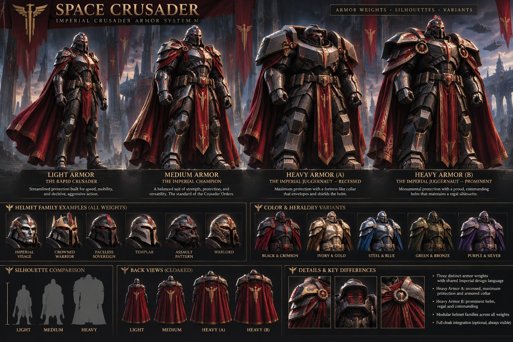
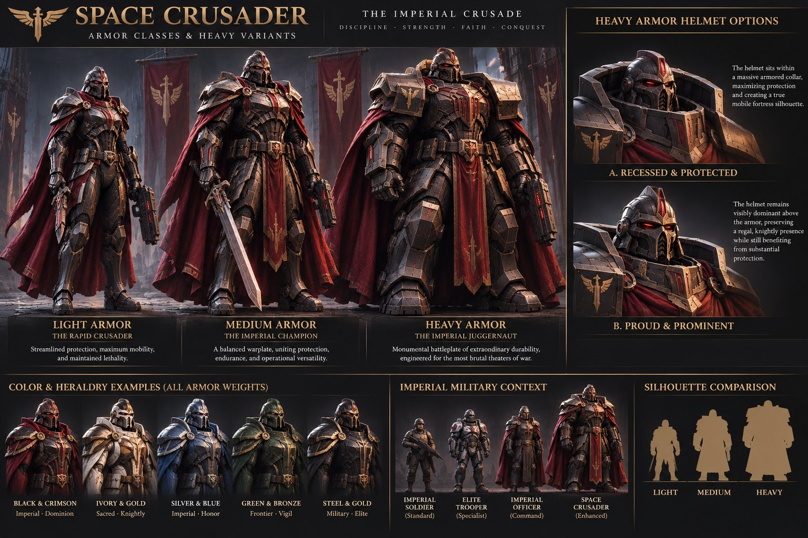

Version 1.0 · 22 November 2026

This document defines the first playable foundation and opening operation for Imperial Space. It covers the game's intended experience, combat and equipment, Developer Arena, art production, proposed characters, mission design, technical architecture, scope, and acceptance requirements.

**Build the fundamentals and permanent Developer Arena first.** Use the arena to establish a responsive, attractive Crusader and enjoyable combat before assembling the opening invasion. The long-term living galaxy remains a direction for later production.

The companion ZIP contains the authoritative separate Markdown chapters, agent instructions, a ready-to-paste Work Mode prompt, context-maintenance templates, five compact art boards, and tested asset-preflight utilities. This is a design handoff, not a completed game. Newly proposed names and numerical tuning values remain replaceable production defaults.

# Reading guide

For implementation, start with START_HERE.md and AGENTS.md in the companion package, then the current PROGRESS.md and only the task-relevant chapters. Use this consolidated document for a full review, not as mandatory context for every code edit.

The chapters are ordered for production: vision; roadmap; Developer Arena; combat; art; cast; opening mission; dialogue and UI; architecture; asset safeguards; verification; universe; and decision status. The art appendix shows the earlier concepts with written interpretation. All technical sources are linked in the architecture chapter.

# Vision and Scope

## The game we are making

Imperial Space is a single-player, loot-driven action RPG about being the extraordinary man sent where ordinary forces cannot yet prevail. A Crusader arrives on a burning world, breaks an enemy formation, saves a position that was about to fall, and earns the equipment and influence to undertake greater campaigns. His strength is personal. Armor augments an already exceptional human being.

Between operations, he returns to his cruiser, speaks with recurring crewmates, prepares equipment with his artificer, and chooses the next request worthy of his attention. Eventually he fights across worlds and sectors in a galaxy that reacts to his victories. The player serves an expanding Empire; maintaining the Empire is not his administrative job.

The tone is confident, martial and emotionally sincere. Victories should offer pride, affection, brotherhood, intimidating physical power, and visible benefits to the people protected. Difficult enemies and meaningful decisions give that power something substantial to overcome. Threat comes from readable situations and capable adversaries, not exhausting the player with a stamina system or erasing every upgrade through automatic scaling.

## Pillars and their observable proof

| Pillar | Proof in the first integrated slice |
| --- | --- |
| Physical superiority with real danger | Basic raiders stagger and break; veterans and a warlord require spacing, defense and timing. |
| Freedom of approach | Choose equipment weight before deployment; use a direct route, a flank or a destructible breach. |
| A world worth winning | Defenders recover ground, civilians move to safety, a district visibly stabilizes, and preservation changes the debrief. |
| Desirable equipment | Distinct weapon behavior, a small number of legible upgrades, a meaningful reward, and loadout comparison. |
| A personal Imperial life | Two functional crew contacts, short authored dialogue, and an explorable bridge with adjacent quarters. |
| A foundation that can grow | The arena and mission share combat systems; content and persistent outcomes use stable data identifiers. |

## Scope in three layers

**First runnable foundation:** main menu, settings/pause shell, direct Developer Arena entry, one baseline Crusader representation, movement and aiming, dummy, service rifle, sword, one enemy and rapid reset. Placeholder art is acceptable here if clearly identified. This is the first development deliverable.

**First major integrated slice:** permanent arena plus one compact cruiser hub and one authored opening operation, targeting 20–35 minutes for a first run after tuning. Three connected battlefield zones demonstrate a larger world without pretending to simulate a planet. Shipboard briefing, landing, defenders, Khorgoth combat, a breach, one structural destruction set piece, a lieutenant, a warlord, a consequential ending choice, loot, extraction and debrief all work. Both endings can be exercised directly in the arena fixtures.

**Later game:** multiple campaigns per world, typically two or three playable regions and occasionally larger campaigns; a modest player-facing galactic state; authored main and side plots; procedural operation templates; world-driven production; faction variety, orders, romances and deeper build progression. These are design directions, not features promised for the opening build.

## Content budget for the integrated slice

| Area | Initial commitment |
| --- | --- |
| Player | One production body/rig; three cosmetic character concepts for selection; Light, Medium and Heavy armor profiles with readable silhouettes. |
| Weapons | Three complete firearms: service rifle, precision rifle, heavy cannon. Two melee weapons: sword and hammer. |
| Build expression | One signature special per starter loadout; a small freely respecable set of traits; a mastery data hook with a high baseline. |
| Armor art | One coherent Imperial Standard family in three weights; a small helmet/palette selection after the base animation works. Other traditions remain concept options. |
| Enemies | Khorgoth raider, gunner and veteran; lieutenant variation; one warlord. One static emplacement reuses projectile/damage logic. |
| Allies and civilians | Small authored defender groups and civilian clusters with simple states and purposeful behavior. |
| Environment | Arena; bridge and adjacent quarters; one city/industrial environment kit reused across three mission zones. |
| Destruction | Breakable cover, one breach wall, two readable supports controlling one authored collapse; no arbitrary building simulation. |
| Presentation | Text dialogue, portraits, gameplay camera accents, short animation beats, modest sound and effects. No voiced cinematic pipeline. |
| Persistence | Settings, equipment, progression, mission/checkpoint state, suspend/resume, destruction and an exclusive ending outcome. |

All quantities above are production caps for this slice, not instructions to make every asset in the first session. Armor or crew alternatives must not multiply the animation workload before the base production path is proven.

## Firm exclusions from this build

No multiplayer, spaceship piloting, full cruiser interior, whole-planet traversal, universal destruction, fully simulated alien empires, deep diplomacy, settlement administration, full stealth-assassination boss ecosystem, generative dialogue, voiced cinematics, child-rearing mechanics, loyalty-failsafe storyline, or complete immortality economy. There is no need for microservices, accounts, cloud saves or a procedural universe backend.

Do not implement the Harvesters as a second enemy faction yet. One specific clue introduces them. Do not make future mission cards look playable if those missions do not exist.

## What makes the opening functional

A player can start a new session, select a working loadout, deploy, move and fight without broken inputs, understand objectives, obtain and equip a compatible upgrade, use destruction as an approach, complete the boss and either ending, extract, see accurate rewards and consequences, save, quit and resume. The arena can test these systems without replaying the campaign. The final integrated milestone includes coherent native-scale visuals and readable attack animations; graybox functionality alone is an earlier gate.

This package does not prescribe a calendar promise. Estimate production after measuring the cost of one finished character animation set, one enemy role, one environment module and one complete arena test loop. Protect combat feel and readable art first; reduce content breadth before polishing an unproven campaign.

# Production roadmap

## Delivery strategy

Build the fundamentals, prove combat in a permanent Developer Arena, then integrate the opening mission. **The first deliverable is a runnable development foundation with direct arena access, not a finished planetary campaign.** The first major integrated milestone is the opening operation with both outcomes and a useful shipboard loop. This packet specifies the work; it does not contain a completed game.

The default recommendation is a single-player PC game in Godot 4 with typed GDScript and a 2D, three-quarter presentation. Verify the actual repository, installed engine, export support and existing code before choosing a pinned engine version. If a suitable project already exists, extend it rather than replacing it. Record technical deviations with their reasons. Work Mode may make routine reversible choices without another design interview.

No calendar estimate is committed here. Effort depends especially on usable character animation, engine familiarity, asset quality and the observed combat iteration rate. Track completed gates and remaining risks; do not equate generated code volume with a playable result.

## M0 Project foundation

Create or inspect the repository; establish its run instructions, version pin and ignore rules. Implement a boot scene and minimal main menu with **Developer Arena**, settings and quit. Add pause, input actions, basic audio/display preferences, a visible build identifier and a development-only entry override. The arena initially may be a gray floor, player placeholder and camera. Store settings independently from campaign progress.

**Gate:** A clean checkout launches to a usable menu and reaches the empty arena directly. Pause and quit work. Missing optional art does not prevent boot. Work Mode records the exact launch method and what was actually executed. Headless script checks supplement, but do not replace, launching the game.

## M1 Movement and visual proof

Build one production player controller and a representative movement space in the arena. Establish scale against an ordinary human, a doorway, a railing and a Khorgoth placeholder. Tune aim facing, movement, collisions, camera follow and input ownership. UI interaction must not fire a weapon behind the panel.

At the same time, test one medium armor design at the actual game camera size with its helmet and equipped cloak visible. Prove feet pivots, directional poses and one attack. Start with deliberately limited poses if needed, but label them placeholders. Choose the character asset pipeline based on this result. Do not create dozens of armor variants before one actor moves convincingly.

**Gate:** Movement feels responsive, diagonal movement is normalized, scale is coherent, and the player remains readable against a representative environment. A still concept image alone cannot pass the animation gate. If animation quality fails, simplify the presentation or improve the asset workflow before enlarging the content set.

## M2 Shared combat in the arena

Implement health, damage, a service rifle, a sword, melee contact timing, ammo/reload, hit feedback, dodge, guard and parry. There is no stamina meter. Add a stationary target, one raider and one gunner using the same actors and combat rules that campaign scenes will use. Add spawn/clear, refill and a one-action reset with repeatable presets.

Prove damage attribution, one-hit-per-swing rules, shot collision, enemy telegraphs and stagger. Add sound early: impacts and gunfire are part of evaluating feel. Use temporary clearly identified audio if final audio is unavailable. Confirm that appropriate play creates openings and benefits without requiring a generic momentum currency.

**Gate:** The developer can enter the arena and fight without playing any story. A new encounter and a reset are quick. Death and restart work. Holding attack, alternating inputs, parry timing and shots against walls do not create obvious exploit or collision failures. The arena uses production combat scenes, not a disconnected toy implementation.

## M3 Loadouts and build expression

Add Light, Medium and Heavy armor functions using a shared body baseline. Add the precision rifle and heavy cannon, plus the hammer: **three firearms and two melee weapons total**. Give each armor role one initial special and a small set of freely respecable traits. Begin simple weapon mastery with a high baseline competence; its initial progression may be a modest proof rather than a full campaign balance curve.

Add inventory/equipment UI, coherent item definitions and runtime item instances. The normal deployment restricts armor type; arena loadout changes are deliberately unrestricted and cannot affect a campaign save. Starting appearance concepts are selection proposals. Do not require three fully independent animated physiques or every crew alternative before this gate.

**Gate:** Each weight has a recognizable style of play, both melee weapons and all three firearms work, and arena swapping takes only a few actions. No preferred style depends on finding a specific random drop. Cosmetic tradition is independent from weight. New equipment does not mutate every item sharing its definition.

## M4 Destruction and persistence

Add an arena destruction lane with intact/breached walls, cover, an explosive and a deliberately authored structural collapse. Integrate navigation changes and persistent destroyed-state identifiers. Keep rubble effects bounded; do not simulate a whole building to destroy one useful route.

Implement versioned saves, atomic writes, stable IDs and campaign checkpoint versus suspend behavior. Add isolated arena settings/presets and deterministic scenario reset. Extend the arena with representative elite and boss mechanics before writing the full narrative around them. Add inspectable, bounded diagnostics for contacts, damage sources, AI states and timing.

**Gate:** Destruction affects collision and routes consistently, reload restores the correct world state without duplicate loot or actors, and arena experiments cannot contaminate campaign progress. Validate interrupted or invalid saves safely. Developer cheats are conspicuous and cleared on transition back to normal play.

## M5 Opening operation integration

Build the compact bridge/personal quarters interaction space, initially with one captain and one artificer functional. Use portraits, text and radio for other characters. Connect mission briefing, loadout, deployment, three authored combat zones, the lieutenant, warlord duel, arm loss, the consequential rescue/pursuit branch, debrief and rewards.

Use existing arena-proven systems. Implement the first 20–35 minute operation as an explicit pacing target to measure, not a guaranteed runtime. Clearly identify future mission hooks as future content. A small handcrafted operation proves the campaign structure; it is not a commitment that every planet takes one mission.

**Gate:** A fresh run reaches either legitimate ending, the chosen outcome survives save/load, rewards are granted once, and the restored district has visible changes. Rescue and pursuit receive comparable reward budgets with different consequences. The player can resume after defeat without pretending every lethal encounter caused a new canonical death.

## M6 Integrated review and delivery

Review readability, animation, sound, input consistency, UI scale, performance and save reliability on the declared test machine. Run a compact representative matrix from the QA chapter: three armor roles, both endings, destruction, suspension and checkpoint recovery, plus the highest-risk input combinations. Fix blockers; do not repeat every test without a changed risk.

Export a playable build with clear controls and known limitations. Keep the Developer Arena available for development review. Attach small native gameplay screenshots, exact build/run instructions and a short evidence-based test report. Do not present generated concept art as a screenshot from the build.

**Gate:** Another person can start the delivered build, use the arena, play the opening and understand what is implemented. Remaining placeholders are named. A compilation success or a polished menu alone is insufficient.

## Expansion after the opening works

Add content in useful increments: more enemy combinations; stronger armor and weapon visual variety; a second authored operation; richer crew interactions; then a bounded regional campaign generator. World supply, simplified crafting, side plots and event-driven territorial changes follow once they can reuse stable mission systems. A living galaxy should create opportunities, not a constant obligation to defend everything yourself.

Full galaxy simulation, seamless planets, multiplayer, full cruiser interiors, ship piloting, elaborate modular gun assembly, voice production, procedural cutscenes and a complete population simulation remain outside the opening scope. Keep extension points small; do not build speculative frameworks for every eventual idea.

## Handoff at every milestone

Update `PROGRESS.md` with the exact working state, update relevant decisions, and record meaningful validation in `TEST_REPORT.md`. Include the next smallest useful implementation task. If a gate is blocked, describe the concrete blocker and a reversible remedy. Continue useful authorized work instead of waiting for permission on every implementation detail; ask only when a genuine product choice or access requirement prevents progress.

# Developer Arena

## Purpose

This is a permanent development feature and the first substantial playable deliverable. The owner must be able to launch the game, enter a fight, change equipment, break a wall and reset without playing a campaign introduction. Every later combat feature receives an Arena scenario before it is relied upon in a mission.

The Arena is a small menu-driven test space. It is not a separate game, an elaborate editor or an endgame mode. Reuse production player, enemy, damage, loot and destruction scenes; only setup, diagnostics and reset belong to the developer layer.

## Entry and isolation

Put **Developer Arena** directly on the development build's main menu. Support a documented launch argument that selects it immediately. Target a usable empty arena within 15 seconds on the agreed test machine after startup, then measure the result; this is a usability goal, not a current performance claim.

Use an explicit `ARENA` session mode, a separate random seed and separate developer preferences. The Arena must never read or write campaign progression, mastery, achievements, mission outcomes, inventory or autosaves. It may load shared immutable definitions. Arena equipment instances are temporary copies. Leaving it clears debug damage, invulnerability, time scale and spawned entities before another mode starts.

Show a persistent **DEVELOPER ARENA** label. Active cheats must be obvious. Entering the Arena does not require a campaign save. A player's normal game remains available and untouched on exit.

## The first room

Use a flat, bounded floor with a visible scale grid toggle, clear walls, a shooting lane, a melee lane and a small breach lane. Include a few human-scale reference props and one ordinary soldier silhouette to judge Crusader size. The floor must be visually readable before decoration is added.

Provide marked spawn positions and enough open space to test dodges and approaches. Add a cover corner, a narrow passage, a breakable wall and a two-support gantry as capabilities mature. Spawn placement rejects occupied or invalid positions instead of stacking enemies inside the player.

## Controls that remove friction

Keep the default panel compact. Expose advanced diagnostics behind a foldout. Keyboard shortcuts are convenience bindings and remain remappable.

| Control | Required result |
| --- | --- |
| Scenario selector | Loads a named scenario with its visible seed and intended test. |
| Start / restart | Builds that scenario from a clean initial state in one action. |
| Clear enemies | Removes enemies and their attacks without damaging the player. |
| Refill player | Restores health, medical charges, magazine, reserve ammunition and ability availability. |
| Loadout selector | Applies any of the three weight presets without leaving the Arena. |
| Individual gear selector | Swaps weapons, armor and traits; shows the active setup. |
| Spawn controls | Choose enemy type, count, formation and passive or active behavior. |
| Reset destruction | Restores the test fixtures and their collision/navigation state. |
| Pause / step | Freezes simulation; advances one simulation tick for diagnostics. |
| Diagnostics | Toggle collision shapes, hit regions, sight lines, navigation and simple timing information. |
| Exit | Returns to the main menu and resets developer overrides. |

Do not bury spawning beneath multiple confirmation windows. Destructive reset only affects an isolated test session. Changing a scenario can reset it directly because there is no campaign progress to lose.

## Scenario library

| Preset | Main question | Stage |
| --- | --- | --- |
| Empty floor | Do movement, aiming, camera, pause and facing work? | First runnable foundation |
| Dummy range | Do shots and swings register once, at the right place and time? | Core combat |
| Raider duel | Can a player read, guard, parry and dodge a single enemy? | Core combat |
| Mixed squad | Are melee pressure, gunner fire and cover readable together? | Enemy expansion |
| Destruction lane | Do wall breaches and support collapse update every affected system? | Destruction |
| Light approach | Does detection reward route choice without omniscience? | Limited stealth |
| Warlord duel | Are boss attacks, arm loss and state transitions robust? | Mission preparation |
| Crisis resolution | Do both branch objectives, committed checkpoints, outcomes and one-time rewards work? | Mission integration |
| Stress formation | What is the practical enemy and effect budget on the target machine? | Performance review |

The Crisis resolution fixture starts immediately before the rescue/pursuit choice and uses the production mission controller and short branch objectives. It can exercise either ending without replaying the campaign. Rewards and world outcomes remain inside the isolated Arena session.

The stress preset uses explicit counts such as 5, 10, 20 and 40 actors; these are measurement points, not promised production encounter sizes. Keep count caps configurable and report the machine and settings with results.

## Reset and reproducibility

Store a scenario definition containing stable IDs for the selected map, actors, equipment, player start, fixture states and seed. **Restart** reconstructs this baseline. It clears projectiles, delayed attacks, particles, damage-over-time effects, corpses, temporary loot, AI targets, pending callbacks and runtime path caches. It restores time scale and health. Do not achieve reset by merely teleporting actors to their start positions.

The same scenario and seed should reproduce the initial setup and random choices. Do not promise bit-perfect replay across engine versions or hardware. A bug report should contain scenario ID, seed, build revision, loadout, actions taken and expected versus observed behavior. A small bounded event log can report attack start, contact, damage, guard/parry result and death. Keep it off by default and never flood normal output with per-frame messages.

Expose invulnerability, passive enemies, frozen AI, unlimited ammunition and immediate cooldowns individually. Defaults use real game rules. Tuning fields may override session values, but changing a resource in the Arena must not silently edit the game's shipped balance data. Provide a deliberate export of selected tuning values for review if needed later.

## Delivery sequence

1. Build empty-floor movement, direct entry, pause, exit and reliable reset.
2. Add the service rifle, sword, dummy and raider; prove hit detection and basic defense.
3. Add loadout switching, remaining weapons, weight representations, traits and mixed enemies.
4. Add destruction fixtures and a limited detection encounter.
5. Add the lieutenant and warlord presets, then integrate their proven behaviors into the opening mission.

Do not postpone basic access and reset until the campaign exists. Conversely, do not delay a useful first playable while building every diagnostic listed here. Grow the Arena alongside the production systems, keeping its controls useful at every stage.

# Combat and Equipment

## Purpose and authority

Build a responsive, readable action RPG in which one exceptional man breaks a battlefield open. The Crusader is already formidable at the start. His equipment and good decisions produce specialization; he never needs to train basic competence. This specification supplies implementation defaults, not measured balance results. All numbers below are provisional tuning values.

The permanent [Developer Arena](docs/12_DEVELOPER_ARENA.md) proves these systems before the opening mission consumes production time. Use the same actors, equipment definitions, damage resolution, movement and destruction code in both modes.

## Locked principles

- No stamina resource. Walking, sprinting, ordinary attacks, blocking and dodging never consume a replenishing action budget.
- Momentum describes rewarding good play. Do not add a momentum meter or a build and spend economy.
- Basic actions remain useful while special abilities recharge. Cooldowns control extraordinary actions, not permission to participate in combat.
- Blocking, parrying, dodging, positioning, aim and target selection all matter. Attacks are dangerous through their behavior and readable consequences, not just large health pools.
- Melee, ranged, mixed and eventually stealth or commander approaches must be viable. Do not adapt enemies to punish whichever equipment the player enjoys.
- Armor augments the man. Avoid a tiny pilot inside a walking vehicle. Helmets stay on in combat; an equipped cloak stays visible.

## Camera and controls

Recommended foundation: a three-quarter 2D view, ground-plane movement and independent mouse aim. Keep aim, world position and illustrated sprite facing distinct. A sprite changing facing must not rotate or move its collision body incorrectly. Test the actual camera scale before commissioning directional animation.

| Action | Proposed default | Behavior |
| --- | --- | --- |
| Move | WASD | Normalize diagonal input; movement does not require a target. |
| Fire ranged weapon | Left mouse | Aim toward cursor; release/hold behavior follows weapon. |
| Melee | Right mouse | Directional attack, including without a selected enemy. |
| Dodge | Space | Directional step with a short animation and bounded recovery. |
| Guard and parry | Left Shift | Hold to guard; initial timed window can parry. |
| Reload | R | Explicit reload; optional automatic reload on empty. |
| Interact | E | Context action with visible prompt. |
| Execution | F | Only against an eligible nearby enemy; never the interact key. |
| Heal | Q | Limited medical charge; generous replenishment. |
| Special abilities | 1–3 | One active slot initially; additional slots come later. |
| Map / equipment | Tab / I | Pause single-player simulation while open. |
| Pause | Escape | Pauses combat and mission timers. |
| Arena panel | F1 | Developer mode only. |

Use named, remappable InputMap actions. Consume clicks in menus so closing a panel cannot fire a gun. Support hold/toggle guard and reduced camera shake. A short configurable input buffer should make deliberate follow-ups reliable without queuing an entire unwanted combo. Controller support is a later milestone unless the chosen project already has it.

## The core combat loop

Spot a threat, choose a route, commit to an attack, read the answer and respond. Melee and ranged weapons are simultaneously equipped, but one action controller owns the current attack, guard, reload or dodge. Clearly specify which actions can interrupt which states. Do not allow duplicate damage from overlapping animation frames or an attack that hits after it has been cancelled.

Start with a short, satisfying sword sequence and a slower hammer strike. Every attack has anticipation, contact and recovery. Impact comes from animation, hit reaction, sound, brief hit stop, particles and restrained screen movement. These treatments must preserve visibility of the next incoming attack. The sword cuts through light enemies; the hammer can interrupt a committed brute at the right moment. Neither is just a different damage number.

Firearms use ballistic presentation: report, recoil, tracer where appropriate, impact, casings and forceful reactions. Use reliable ray or swept collision for fast projectiles; presentation does not require simulating every bullet as a physics object. Gunfire hits the first valid obstruction. Avoid shooting through cover because the muzzle is on the wrong side of a wall.

### Defense without stamina

Guard protects a forward arc and reduces ordinary incoming damage. A correctly timed parry against a marked parryable attack interrupts or exposes the attacker. Heavy attacks can break a held guard and briefly stagger the player; ground effects and clearly signaled unblockable attacks require movement. Guard break is an attack consequence, not a draining stamina substitute.

Initial test values: approximately 0.15 seconds of parry opportunity, 0.25 seconds of dodge movement and 0.15 seconds of recovery. Tune from recordings, input latency and player feedback. Do not ship these as unquestioned constants. Repeatedly tapping guard must not restart a free parry window every frame; apply a short rearm rule. Dodging must not grant continuous invulnerability through animation cancellation. Both remain immediately available again after their brief committed actions.

Basic healing can come from medical charges, safe recovery and specific talents. A successful parry might briefly increase recovery. Holding guard in a corner must not generate an unlimited healing loop. Supply placements should prevent an ammunition shortage from forcing a ranged build to finish a mission with an unwanted weapon.

## Equipment and build scope

The first integrated slice contains three armor weight prototypes, three complete firearms, two melee weapons, one active ability per weight, a small trait selection and a handful of meaningful loot variants. It does not require a sprawling crafting interface or dozens of weapon parts.

| Loadout example | Equipment | Distinct experience | First special |
| --- | --- | --- | --- |
| Light hunter | Precision rifle, sword, light armor | Faster repositioning, deliberate shots, flank routes and awareness | Combat Sprint: short movement burst; no teleport or invisibility |
| Medium champion | Service rifle, sword, medium armor | Versatile shooting, parrying and aggressive close combat | Rally: brief recovery and stagger-resistance benefit |
| Heavy breaker | Heavy cannon, hammer, heavy armor | Forceful advances, suppression, breaches and close impact | Breach: committed short rush that interrupts suitable targets and breaks marked weak structures |

These are presets, not classes. Any weight can equip any of the five weapons unless a specific future item has a stated requirement. A light Crusader holding a cannon remains formidable; its handling, noise and recoil create tradeoffs. All three must complete the same authored mission.

Choose armor weight at deployment. During a mission, swap compatible pieces of that weight; other pieces go into inventory for the ship. Visual traditions such as Imperial Standard, Knightly and Military are cosmetic families independent of weight. Each weight must remain readable beneath color and ornament. The initial art workload is one base body and a limited set of readable armor representations, not a full matrix of every body, tradition, helmet and animation.

Armor is personally encoded. Treat newly found compatible components as unbound parts that the Crusader's authorized equipment can pair locally; do not imply a stranger can wear his whole personal suit. This is a proposed reconciliation for instant field upgrades, with no extra minigame.

### Small progression implementation

Begin with two freely selectable trait slots and six traits: improved recovery after parry, reduced ranged handling penalty after movement, a stronger first melee strike after a dodge, improved medical charge recovery, wider heavy-weapon suppression and a longer short-range detection grace period. Define a trigger, benefit, duration and internal cooldown for each. Avoid effects that recursively trigger themselves. This small selection demonstrates build choices; a full skill tree can follow proven combat.

Weapon-family mastery starts at a high competence floor. Record legitimate combat use and grant a modest first mastery benefit, such as a small reload or recovery improvement. New weapon families must feel good immediately. Do not force dummy farming, and never award campaign mastery from the Arena. Retain earned mastery when respeccing traits. The full game can add more interesting mastery unlocks after this small implementation works.

Loot is a complete item with a clear base identity and a few understandable properties. Prefer one interesting upgrade after a meaningful encounter over piles of near-identical junk. Prototype rarities can be Standard, Refined and Distinguished; names are provisional. One or two editable modifiers, such as ammunition type, are enough. Compare damage behavior, handling, useful effects and armor compatibility without a wall of percentages.

Keep item definitions immutable and item instances individually identified. Equipping one copy must not modify every item sharing its resource. Knowledge of unlocked fabrication survives a later loss of the supplying world; current material access may change. The first slice only needs a foundry-related unlock or resource reward, not an empire manufacturing simulation.

## Enemies and fair threat

Start with a training dummy and a melee raider. Add a gunner, a tougher veteran, a stationary emplacement, the lieutenant and the warlord through later Arena presets. Reuse rigs and core behaviors where credible; do not require seven unrelated animation pipelines before proving one attack.

Raiders close aggressively; gunners seek useful firing positions; veterans time or cover an approach. The warlord has a small set of legible attacks and meaningful openings. Ordinary human allies are competent but overwhelmed. Enemies respond to what they perceive and their faction's courage or discipline, not perfect knowledge of the player's cursor, inventory or position behind walls.

Stealth eventually uses sight, sound, suspicion, last-known position, search and alarm. A suppressed weapon reduces detection rather than deleting it. A commander can retreat, summon help or spring a prepared trap when that behavior is established and readable. The slice may demonstrate a flank and a short detection encounter; a fully systemic assassination of every boss is deferred. This limitation does not establish boss immunity as a permanent design rule.

Executions require a meaningful opening and a conscious input. Keep them short and prevent guaranteed invulnerability loops. A vulnerability indicator must be legible without requiring a fixed cinematic camera. Dismemberment is selective and authored; the warlord's arm loss is a specific narrative state, not a promise of arbitrary anatomical simulation.

## Destruction and defeat

Prototype three destruction classes: cosmetic breakables, cover that changes collision, and authored structural objectives with explicit support rules. A breached wall updates collision, navigation and line of sight together. Debris is capped and mostly cosmetic. Destruction can open a fast route while harming a settlement or reducing its surviving infrastructure. Record concrete outcomes; avoid a universal morality score.

Pause and suspend preserve the current expedition. Combat defeat reloads the latest designated checkpoint as a retry of the encounter. A real withdrawal, when offered, is a separate explicitly chosen outcome. Do not simultaneously claim the player canonically lost a world and restore it through a retry. The medical recovery fiction can explain ordinary recoverable failures later; it must not silently undo a completed story choice.

An ending decision commits once, with consistent mission and world flags. Suspension after committing it must preserve that choice. The opening mission's civilian rescue and warlord pursuit outcomes receive comparable reward budgets with different benefits; neither is secretly the only route to viable equipment.

# Art Direction and Production

## Chosen direction

Use colorful, readable illustrated science fiction with heroic anatomy, substantial materials and an industrial foundation. The preferred visual comparison is option B: stronger color separation, expressive portraits and clear silhouettes. Its rounded armor is not an approved final character. Keep the readability while moving the Crusader toward a tall, imposing, regal silhouette.

Black and crimson express strength and authority; they do not automatically signify villainy. Ivory/gold, steel/blue, charcoal/bronze and restrained forest green also belong. An Imperial standard creates a common visual language, while personal artificers allow distinct equipment traditions.

## Shape language

Crusaders are noticeably larger than ordinary men, with powerful shoulders, a muscular chest, strong legs and a visible waist. Preserve the impression of a formidable man inside armor. A broad but integrated shoulder line, long vertical plates, a high uniform-like collar, severe mask and heavy cloth produce authority without relying on enormous spherical shoulder pads.

Use original panel proportions and construction. Avoid the combined silhouette of Space Marine round pauldrons, barrel chest and oversized backpack; avoid a recognizable Vader helmet, breathing panel or chest control box; avoid a recognizable Spartan helmet/visor package. These are visual development exclusions, not a legal clearance opinion. Franchise names remain internal reference shorthand and should not appear in game-facing names or marketing.

| Weight | Required visual behavior | Avoid |
| --- | --- | --- |
| Light | Compact full protection, articulated joints, narrow equipment profile, enough freedom for precise footwork. | A normal-sized weak scout, exposed combat face, or unarmored bodysuit replacing the Crusader fantasy. |
| Medium | Heroic proportions, visible torso articulation, strong uniform collar, balanced plates and equipment. | Generic tactical soldier silhouette with no regal character. |
| Heavy | Squared mass, layered chest and shoulders, raised collar, braced hips and powerful feet; visible human head/torso relationship. | Simply enlarging Medium, hiding every human proportion, or duplicating a recognizable franchise suit. |

The favored heavy study uses a collar-like enclosure around the head. Both a recessed protected head and a more prominent helm can exist as variants. Prototype one. The user has not required a single universal heavy helmet arrangement.

## Traditions and customization

Imperial Standard, Knightly and Military are appearance traditions, independent of weight and build. Standard favors ordered panels, vertical trim and formal collars; Knightly favors faceplate character, heraldry and long cloth; Military favors plain durable surfaces and practical fittings. Norse or more fearsome personal styles can come later without becoming new classes.

The six helmet families in the reference are valid directions for future loot: sculpted visage, crowned, faceless, enclosed knightly, practical assault and imposing warlord. They are not six mandatory launch animation sets. Start with one excellent helmet and palette masks. Do not accept generated labels, tiny emblems or visibly derivative ornament as finalized content.

Combat helmets remain on. A worn cloak remains visible through movement, attacks and transitions. Cloaks are optional equipment presentation. Use a few authored cloth poses or a simple secondary-motion treatment; do not make cloth physics a dependency. Do not hide the cloak to solve every clipping problem. Test weapons, shoulder rotation and cloak occlusion together before multiplying variants.

## Characters and environment scale

Adult male characters are conventionally handsome and masculine; adult female characters are conventionally attractive and feminine. Physiques communicate good health, confidence and capability. Uniforms flatter the wearer while remaining credible for the job. Crew designs need distinct faces, silhouettes, posture and personalities, not interchangeable portraits with different hair. See the cast document for proposed characters.

Use a human defender as the scale reference for doors, rails, consoles, seating and street furniture. Establish dimensions before scattering props. A Crusader should feel large because humans and architecture remain coherent, not because stairs, cover and tables change size between scenes. Objects need contact shadows and believable support; avoid floating set dressing or random indoor furniture outdoors.

Human worlds should contain signs of worthwhile ordinary life: housing, transit, green spaces, functioning workshops, public gathering areas and recognizable civic infrastructure. Show battle damage against that baseline. The restored version changes smoke, light, banners, traffic, barricades and people, using the same modular scene wherever possible.

Khorgoth are heavy, aggressive biological warriors with their own anatomy, tools, trophies and warhost markings. Avoid green comic orcs with a different name. Distinguish roles through stance and equipment silhouettes. Harvesters later contrast attractive near-human masks with a specific unsettling predatory anatomy; do not spend the first art budget on them.

## Practical production route

**Recommendation:** fixed three-quarter 2D presentation with layered character art, selected pose swaps and authored attack frames. This avoids making a complete high-quality 3D character pipeline a prerequisite. It still requires consistent drawing, rigging, animation and integration. A beautiful generated illustration does not automatically produce usable sprites.

Build the following proof in the arena before making a roster:

1. Set one camera scale and ground plane. Target a Crusader approximately 120–160 pixels tall at the initial 1080p view, then adjust by playtest. Keep aim and foot collisions on the ground plane.
2. Put a human defender, a Crusader, one Khorgoth, one door and one piece of cover in the same actual scene. Validate relative scale and readability at normal zoom.
3. Separate required parts only: body, weapon/arms where needed, helmet and cloak. Use consistent pivots at the feet and explicit hand/muzzle anchors per facing and pose.
4. Prove movement, a rifle shot, a sword strike, guard, dodge and a hit reaction. Four facings may be used for the first proof. Target eight for the integrated slice only after the pipeline works; document any reduced-facing compromise and its visual impact.
5. Make near/far arm, weapon and cloak ordering depend on facing. Do not rotate a flat standing illustration around its feet to fake all camera views. Mirroring is acceptable only where it preserves handedness, lighting and asymmetrical equipment.
6. Demonstrate one Medium armor set and one weapon swap with no detached hands or drifting head. Then adapt Light and Heavy silhouettes with shared skeleton/anchors where useful. Do not promise that different proportions share every animation unchanged.
7. Export small frames/atlases, validate them, and inspect the result in motion. Only then add portraits, extra helmets and environment decoration.

Movement and facing may be quantized for art while aiming remains continuous. The muzzle position and projectile ray must agree sufficiently that cover behaves honestly. Transparent cloth must not conceal essential enemy telegraphs; lower distracting contrast or use a restrained outline rather than deleting the cloak.

## Minimum animation inventory

The foundation needs idle, locomotion, rifle firing/reload, sword attack, guard/parry, dodge, hit reaction and defeat. The precision rifle initially reuses the rifle animation profile with its own timing and effects. The integrated slice adds hammer and cannon actions, signature abilities, a short interaction and an execution only if that action is retained. Enemies need readable anticipation, active contact and recovery, plus hit and death. The warlord needs an explicit damaged-arm variant. Placeholder timing effects are acceptable early; they do not satisfy final attack readability.

Do not make every movement frame for every proposed physique. One base Crusader rig and cosmetic portrait choices are enough to validate the game. Different physiques are primarily cosmetic long-term options, not mandatory first-slice body variants.

## References and asset status

Read [the reference guide](reference_art/README.md) before opening the boards. It states which attributes to keep and which remain problematic. The five JPEG derivatives preserve earlier concepts in a manageable form. Source provenance and byte counts are in the manifest; these images belong outside runtime assets.

Prefer purposeful silhouettes, concise impact effects, restrained camera shake, clear hit sounds and readable battlefield contrast over ever larger textures. An actual gameplay screenshot is the evidence for a successful visual milestone. Do not substitute a generated mock screenshot or concept board for that evidence.

# Cast and character options

## Visual and production rules

Use traditional heroic action, science-fiction, and fantasy attractiveness: massive, handsome, masculine Crusaders; fit, handsome male officers; attractive, feminine adult women. Healthy posture, grooming, and flattering uniforms express confidence and competence. Clothing can emphasize shoulders, waist, and silhouette while remaining credible for the character's occupation.

Everyone described here is an adult. Romance is optional and primarily developed through recurring ship characters. Professional respect comes before intimacy; flirting can be warm and direct without making every woman interchangeable or every interaction a reward dispenser. The prototype needs introductions and a small amount of reactive banter, not relationship simulation.

**These names and designs are proposals for selection.** Do not build the entire candidate list before combat works. Establish one production body and animation set, one medium armor, one captain, and one artificer first. Portrait, complexion, hair, and voice-in-text variations are cheaper than three separately animated physiques. Actual body-shape variants require an asset-budget decision later.

## Player presentation presets

These are starting appearances and roleplaying suggestions, not classes. All can use every armor weight, weapon family, and doctrine. Physique is cosmetic. A player may combine a stoic personality with bright armor or an exuberant personality with black and crimson.

| Proposed preset | Appearance | Personality and presentation | Suggested introductory look |
| --- | --- | --- | --- |
| Imperial Laureate | Apparent age 32; handsome square face, dark swept-back hair, strong brows; broad, athletic heroic proportions | Polished, composed, conventionally heroic; dry confidence and public courtesy | Black and crimson Imperial Standard armor, brass detailing, grand cloak, high uniform-like collar |
| Iron Veteran | Apparent age 41; ruggedly handsome face, close beard, an old brow scar; proposed Goliath physique | Laconic and practical; protective of ordinary soldiers; humor delivered without smiling | Gunmetal and deep green Military tradition, restrained insignia, heavy boots and cloak clasp |
| Silver Paladin | Apparent age 30; attractive angular face, fair hair, clean-shaven; proposed tall athletic physique | Earnest, resolute, courteous; fervent conviction expressed through deeds | Ivory, blue, and steel Knightly tradition, angular helmet and substantial blue cloak |

At the initial implementation stage, use portrait and palette presets on the shared body. Label unimplemented physique previews honestly. All combat versions wear helmets. A selected cloak remains visible in combat; do not silently remove it to avoid animation work. Simplified cloak animation is acceptable if it reads well at play scale.

Possible player tone choices in dialogue are **measured**, **heroic**, **fervent**, and **exuberant**. They change wording and small reactions, not the ability to use a weapon or complete an objective. Provide authored lines rather than a large procedural personality engine.

## Captain candidates

The captain runs the vessel, presents requests, and explains available support. The Crusader chooses the mission and approach. A captain can disagree plainly while respecting that relationship.

**Lucan Veyr — default production candidate, apparent age 44.** A handsome, fit man with dark hair silvering at the temples, a clean jaw, and relaxed military bearing. His navy-black uniform uses a high collar, restrained silver piping, a broad belt, and clean boots. Unflappable, observant, and dryly funny; he values accurate information more than theatrics. He admires the protagonist without becoming a sycophant. Sample: “The governor requests immediate assistance. His army has held longer than his transmissions suggest.”

**Seraphine Vale — alternative candidate, apparent age 36.** A beautiful, athletic woman with auburn hair in a disciplined updo and clear, assessing eyes. A tailored navy coat, ivory blouse, structured shoulders, shaped waist, gold rank details, and practical boots create a feminine command silhouette. She is diplomatic, exacting, and quietly formidable, with very dry humor. Sample: “I have prepared three approaches. Naturally, I assumed you would invent a fourth.”

**Cassian Rook — alternative candidate, apparent age 39.** A handsome, broad-shouldered man with bronze skin, a neat beard, and weathered features. His charcoal uniform has crimson panels and worn but carefully maintained metal fittings. Bold, sociable, and delighted by a well-executed risk; he still knows exactly when a ship cannot survive another volley. Sample: “They have a fortified gate. We have you. I favor our engineering.”

## Personal artificer candidates

The artificer maintains the Crusader's personalized armor and weapons, handles outfitting, and later explains supply-dependent crafting. Armor is personal property and biologically paired; the artificer makes it distinctive without requiring every modification to be a separate gameplay system.

**Dorian Rusk — default production candidate, apparent age 52.** A handsome, powerful craftsman with a short gray beard, strong hands, and a charcoal tunic beneath a bronze-trimmed workshop apron. He is exacting, proud of his work, and affectionately abrasive. His admiration appears as relentless improvement: the Crusader deserves better equipment and Dorian intends to provide it. Sample: “The cannon will take the new feed. Try not to mistake the entire district for a firing range.”

**Elira Voss — alternative candidate, apparent age 34.** A beautiful woman with dark braided hair, bright eyes, a fitted deep-green technical tunic, leather work belt, gloves, and a close-fitting protective apron. Curious, witty, and competitive about her craft, she enjoys the protagonist's appetite for difficult work. Sample: “Tell me what you wanted that weapon to do. Then tell me what it actually did.”

## Recurring support candidates

| Role and candidate | Design | Personality and function |
| --- | --- | --- |
| Physician Celene Ardent, 37 | Beautiful, composed woman; pinned dark hair; ivory medical coat with an indigo waist panel and clean metallic fasteners | Warm, firm, and unembarrassed by rank; explains recovery and respects the man beneath the armor. Default medical contact, portrait first. |
| Physician Magnus Thorne, 55 | Handsome, vigorous older man; silver hair; fitted white and charcoal clinical uniform | Patient, humane, quietly sardonic; a veteran of keeping impossible patients alive. Alternative physician. |
| Operations officer Mirelle Damar, 29 | Attractive, feminine woman; black braid; scarlet and charcoal duty uniform with a defined waist and practical boots | Precise, alert, quietly playful; turns scattered reports into useful choices. Default operations contact, portrait or radio first. |
| Operations officer Adrian Sol, 30 | Handsome man; wavy brown hair; navy uniform with bronze details and rolled workshop-style cuffs off duty | Buoyant, resourceful, eager to solve problems; his optimism is backed by preparation. Alternative operations contact. |

The default roster is Lucan, Dorian, Celene, and Mirelle. Only Lucan and Dorian initially require walk-up interactions. Celene and Mirelle can speak through portraits and text. Store candidate choices as IDs so later alternatives do not require rewriting the hub. Character selection should eventually choose authored personalities and looks; it should not combine incompatible lines, portrait traits, or backgrounds at random.

## Opening operation cast

**Sergeant Rellan** leads surviving imperial defenders. He is tired, competent, and visibly relieved by the Crusader's arrival. Give him an ordinary human scale and a restrained uniform so the protagonist's size reads immediately. He provides short practical information while continuing his job.

**Druvak**, the proposed Khorgoth lieutenant, introduces a disciplined enemy response. He uses a shield or reinforced forelimb, orders a flanking pair, and becomes the first named test of intelligent aggression. A trophy can support the later warlord exchange, but the encounter must still work without a bespoke decapitation animation.

**Khorvath**, the proposed warlord, is a dangerous opponent who recognizes strength without becoming friendly. A distinct arm silhouette, brutal command equipment, and an identifiable helmet or face allow the player to recognize him after his injury. Prepare an intact and wounded visual state. A prosthetic rematch is a later content opportunity, not part of the initial asset requirement.

## Minimum character delivery

For the opening milestone, deliver a playable helmeted Crusader, one reusable ordinary-human base, one Khorgoth base with readable role variants, and the warlord variant. Use portraits for dialogue detail. Record each asset's pivot, scale, palette, direction coverage, animation states, license or provenance, and status in the asset manifest. A concept portrait does not count as a combat sprite or animation set.

# Opening mission

## The integrated milestone

**Working operation: The Relief of Karth Vale.** Karth Vale, Druvak, Khorvath, and Rellan are proposed names. This is the first integrated campaign demonstration, built **after** movement, presentation, combat, loadouts, saves, and destruction are proven in the Developer Arena. Do not start by scripting a long cinematic or building the entire city.

Target a first completion of **20–35 minutes**, including brief ship interactions. This is an experience target to measure with playtesting, not a verified duration. Use three compact playable regions with clear transitions and distinct landmarks. The opening can conclude one urgent planetary crisis; ordinary future conquests should usually take several operations.

The player's experience is straightforward: a city is losing a battle; he arrives and changes its course; the enemy proves dangerous enough to deserve attention; victory creates a consequential decision and reveals a larger threat.

## Required content budget

Build one bridge/quarters hub area, a landing perimeter, an industrial district, and a warlord compound. Reuse a single city kit across the combat areas. Include a gunner, a melee raider, a veteran role variant, a lieutenant variation, one emplacement, and the warlord. The veteran and lieutenant should reuse suitable base art and behavior rather than require unrelated production rigs. Vehicles, giant monsters, separate civilian schedules, and fully simulated buildings are unnecessary.

One main route and one alternate approach through the district are enough. Add a small number of explicitly authored destructible walls, supports, and explosive objects. The same damage and destruction components must already work in the Arena. 

## Mission sequence

| Stage | Intended play | Required result |
| --- | --- | --- |
| Ship briefing and departure | Approximately 2–3 minutes; read distress report, choose loadout and direct or flank insertion | Player understands the objective, enemy, mission estimate, and armor commitment |
| Landing perimeter | Approximately 4–6 minutes; break an assault on competent but outmatched defenders | Immediate power fantasy; movement, melee, shooting, and defense are useful |
| Industrial advance | Approximately 5–8 minutes; choose road, service flank, or a marked breach; fight lieutenant | Approach changes combat and infrastructure damage; optional civilians and supplies |
| Warlord compound | Approximately 4–7 minutes; short exchange and readable boss fight | Khorvath loses an arm through an earned combat event |
| Crisis resolution | Approximately 3–5 minutes; pursue or protect the evacuation | One clear outcome, with a short playable task rather than only a menu |
| Return and debrief | Approximately 2–4 minutes | Loot, world condition, and two future story hooks are understood |

These ranges total 20–33 minutes before unusual exploration or retries. Adjust encounter density rather than padding travel to hit a number.

## Landing and advance

The distress call shows burning districts, civilian movement, and a defensive line giving ground. On arrival, use an in-engine landing effect, a short camera settle, and immediate control. A heavy impact, debris, and soldiers' reaction can sell the entrance without a cinematic character performance.

The first pack should let the player interrupt an obvious attack on defenders and scatter weaker enemies. The second introduces a gunner with cover and a threatening telegraph. Rellan continues directing soldiers while giving the player one useful route report. 

The industrial district offers three expressions of the same route decision. The road is direct but covered by an emplacement. The service passage offers cover and a better angle. A marked wall can be breached, shortening the approach while damaging a useful depot or workshop. No approach requires a particular armor class; each makes different tools attractive.

Place one optional rescue and one useful supply cache where they reward attention without becoming a checklist. Clearly distinguish these people from the later evacuation crisis in both narrative and save flags. One structural destruction set piece is sufficient: damaging two visible supports collapses a small gantry into a predefined ruined state. Keep collision, cover, navigation, and the visual change synchronized.

The lieutenant encounter tests a learned skill: flank his protection, parry an announced strike, or interrupt the supporting gunner. Reward the win with a real item or material. Inspecting a damaged administrative terminal reveals evacuation records altered before the invasion. Its identifiers suggest a separate infiltration problem, but the player is not asked to solve it now.

## Warlord encounter and permanent injury

Khorvath acknowledges the protagonist's victories. The selected cold reply can be:

> “I have yet to find a warrior among you.”

A trophy toss is optional presentation. If the asset does not exist, use a portrait exchange and the lieutenant's broken insignia on the ground. Do not block the encounter on a bespoke animation.

The initial slice requires a real duel so its central combat demonstration is reliable. Future light-armor assassination routes remain part of the larger design, but a complete stealth boss system is not a prerequisite here. Telegraph this operation as an alerted battlefield, not an assassination contract whose advertised approach mysteriously fails.

Give Khorvath three readable attacks: a committed close strike, a sweeping attack that punishes standing beside him indefinitely, and a short ranged or thrown attack that prevents effortless circling. One reinforcement wave can test target priority. Use stagger windows and positional opportunity rather than an oversized health pool.

At the final stagger threshold, a short controlled action destroys his weapon arm. Clamp the encounter into this authored transition so projectile damage cannot accidentally skip the required wounded state. This is an explicit encounter phase, not an unexplained resurrection. The arm injury persists in both outcomes. Swap to the wounded actor state and change his behavior immediately.

## The crisis and the choice

Establish the relevant logistics before the duel. An enemy ground battery is targeting an evacuation corridor. Its targeting relay is inside the compound; a separate armored departure lane connects to Khorvath's transport. Allied infantry can hold the corridor but cannot cross to the battery. The ship's immediate support craft is already extracting wounded troops and cannot cover both locations.

After his injury, Khorvath starts a prepared withdrawal and orders the battery to fire. The player can personally reach the relay in time to stop the strike, or intercept the retreat before its armored transport clears the compound. Present both goals and their consequences plainly. Use the visible layout, travel distance, and a short established departure sequence to justify the conflict; do not invent an invisible wall or silently declare a successful second action invalid.

For the prototype, a tactical choice confirmation reserves the associated immediate support task and commits the mission branch. This is an authored scenario choice, not a claim that a fully simulated world has proved every conceivable solution impossible. The player then completes a short physical objective. Before confirmation, allow reconsideration; after confirmation, explain the other event through visible action or a report. Avoid a surprise timer during dialogue or inventory use.

**Protect the evacuation:** break through to the relay, disable it, and defeat its remaining guard. Civilians escape; Khorvath departs wounded. The district retains more labor and infrastructure, and the officer reports the people saved. A later revenge operation is suggested, not already implemented.

**Finish the warlord:** breach his departure position and complete a short final exchange. Khorvath dies; the battery hits the evacuation area before allied troops disable it. Show the consequence with a damaged scene state and restrained reports, not an expensive mass-casualty cinematic. His warhost loses its leader, reducing its immediate capacity to reorganize.

Both routes complete the operation successfully. Use equivalent overall loot and progression budgets, with different material or equipment emphases. Do not reserve the only exciting weapon for one moral choice. The larger game can contain demanding opportunities to achieve exceptional outcomes; a secret “save everyone and kill him” solution is outside this first authored scope.

## Resolution and visible restoration

The final scene shows defenders advancing, fires being contained, imperial banners or lights returning, and at least one useful service reopening. The rescue path includes a larger civilian group and a less damaged transit area. The pursuit path shows reduced enemy command pressure but a damaged evacuation sector. The world is improved by the invasion being broken in either case, with a different cost.

On the ship, the captain responds to the chosen priority and the artificer acknowledges recovered supplies. Add a wounded-warlord lead only if he escaped, and a Harvester-infiltration lead on both paths. Label these cards as future operations in the prototype. A debrief should not imply a playable galaxy exists when it does not.

## State and recovery contract

Store separate stable fields for optional district rescue, depot condition, lieutenant defeat, clue discovered and warlord arm lost. Separate `branch_choice` (`none`, `rescue`, `pursuit`) from `mission_status` (`active`, `completed`) and `final_outcome` (`unresolved`, `evacuation_secured`, `warlord_killed`). Confirming a branch records the commitment and its immediate opposing event, but does not claim that the player's remaining objective is already complete. Record rewards as granted once, tied to the completed mission instance.

Keep a checkpoint before the duel and before branch confirmation. On confirmation, atomically create a committed-branch checkpoint for the remaining objective. Defeat after commitment retries that branch; it does not return to the uncommitted choice. Set the completed outcome and grant its rewards together only when the remaining objective succeeds. A suspend save preserves the current state. Earlier checkpoints remain available for isolated developer tests, not as a way to collect both outcomes in the same campaign instance. Reloading must not duplicate loot, restore the arm or kill an escaped warlord.

For ordinary defeat, the campaign may explain a withdrawal or medical recovery when the scene supports it. At this tightly authored climax, checkpoint retry is the honest implementation. A brief recovery-flavored loading line is acceptable, but no alternate defeat storyline is required. The functional milestone is complete only after both branches, both save boundaries, and reward idempotency have been exercised.

# Dialogue and interface

## Presentation

Use text-first classic ARPG presentation: a compact portrait, speaker name, readable text, and a few authored response choices. Voice acting is deferred. The important spectacle happens through the controlled character, enemy reactions, effects, environmental changes, and occasional short camera emphasis.

Dialogue should support momentum. A typical mission exchange is two to six short lines; optional ship conversations can be longer. Give each character a consistent vocabulary and sense of humor. Avoid making every officer an exposition terminal or every Crusader response a quip. Confidence often reads best as a short, unembellished sentence.

Pause single-player combat and mission urgency during full dialogue, pause menus, and inventory. Brief battlefield barks can appear without stealing control. Never let an enemy attack continue behind a modal conversation. Subtitles and interface text must remain legible over bright fire, smoke, and dark armor.

## Main menu and ship hub

The main menu exposes **Continue**, **New Campaign**, **Developer Arena**, **Settings**, and **Quit**. The Arena must be accessible without completing an intro or loading a campaign save. Show unavailable actions as unavailable with a reason, not as buttons that fail silently.

The hub is a compact bridge and personal quarters. Walking to the captain opens operations; the artificer opens equipment. Provide menu shortcuts to the same functions so routine outfitting never requires an unnecessary walk. The visible ship establishes companionship and status without requiring a fully navigable cruiser.

A deployment card displays objective, enemy faction, expected duration, complexity, known hazards, likely rewards, and selected armor weight. The opening card can read “20–35 minutes · several encounters · named commander.” Treat that estimate as provisional until playtested. Before departure, clearly state that armor weight is committed for the operation, while compatible components may still be equipped in the field.

## Equipment and progression

Show complete weapons, recognizable armor slots, and a small number of understandable modifiers. Comparison emphasizes a few useful properties: damage behavior, firing or attack rhythm, armor interaction, and the modifier's actual effect. Avoid a dozen tiny percentages before the player understands the weapon.

If a heavy deployment finds light boots, allow inspection and storage but explain that equipping them requires returning to outfitting. Do not destroy the loot or quietly change the deployment class. Visual tradition and palette stay separate from weight and statistics. Compatible field components are locally paired to the Crusader; the fiction must not contradict the ability to equip upgrades.

Build presets are suggestions the player can change. A small, freely adjustable trait panel is enough for the first milestone. Show weapon mastery as improvement from an already high baseline, not as permission to use an unfamiliar weapon competently. Future trees and crafting options should be represented by stable data hooks, not a screen full of nonfunctional buttons.

## Combat interface

Keep health, ammunition, cooldowns, selected equipment, and the immediate objective readable. There is **no stamina bar** and no momentum meter. Conditional buffs can use brief icons with plain explanations. Telegraph enemies through animation, sound, and consistent shape cues, not color alone.

Allow damage-number density and screen shake to be reduced. Make aim, interaction, and input hints adapt to remapping. Opening a menu must consume its mouse click so the same input cannot fire a gun into the scene behind it. Use action names in dialogue and help text rather than baking keyboard letters into prose.

## Sample opening exchanges

**Distress report**

Rellan: “Our line is still holding. The eastern battery will end that.”

Crusader, measured: “Then it will cease firing.”

Crusader, heroic: “Keep your people behind me.”

Crusader, exuberant: “Good. Something worth landing for.”

**Before the warlord**

Khorvath: “I see you have slain many of my warriors.”

Crusader: “I have yet to find a warrior among you.”

**Crisis report**

Lucan: “The battery has the evacuation corridor. Khorvath is withdrawing through the west lane. You can stop the strike or reach his transport before it clears the compound.”

Choices: “Secure the evacuation” and “Finish Khorvath.” Each receives a one-sentence consequence description before commitment. Do not label either “good,” “evil,” or “correct.”

**After rescue**

Lucan: “The corridor is clear. Rellan is bringing them home.”

Crusader: “Track the warlord. He has left me unfinished work.”

**After pursuit**

Lucan: “Their command net has collapsed. The evacuation sector took the strike.”

Crusader: “Get relief to the survivors. Then show me what remains of his host.”

## Dialogue data and reactive limits

Store dialogue in small structured records with stable IDs, speaker IDs, localization keys, conditions, and explicitly permitted effects. A choice can set a mission flag or select an authored response; it must not execute arbitrary code embedded in text. Evaluate prerequisites before showing choices and validate them again on selection.

For the prototype, support a handful of conditions: mission phase, selected tone, optional rescue, infrastructure state, and outcome. Do not build a universal relationship simulator. Limit reactive debriefs to a few tested variations, with a neutral fallback if a nonessential condition is absent.

The later loyalty-safeguard narrative is deliberately excluded. No ordinary menu should mysteriously rewrite a choice or imply a bug in the prototype. If that branch is built later, its interaction design requires separate tests and clear narrative preparation.

## Developer interface

The Arena can expose technical information because its user is the developer: hitboxes, AI state, damage events, time scale, spawning, invulnerability, and reset controls. Keep that interface visually distinct from campaign menus. Debug state must never leak into a campaign save or create unexplained player advantages after leaving the Arena. The detailed workflow and scenarios live in `12_DEVELOPER_ARENA.md`.

# Technical Architecture

## Starting stack and repository

Recommended stack: Godot 4, typed GDScript, native 2D gameplay and a fixed three-quarter presentation. Start with the Compatibility renderer unless a measured feature need justifies another renderer. Use mouse and keyboard first; action-based input keeps later controller support possible. Target Windows desktop; verify exports on available hardware and label other platforms untested.

Discover the installed engine, export templates and existing project before deciding the exact version. Pin the tested minor and patch in the repository README and progress file. Use documentation for that version after pinning. Do not silently upgrade the engine mid-milestone.

Keep `game/project.godot` and runtime content under `game/`. Keep `docs/`, `reference_art/`, `tools/`, source art and full test captures outside that runtime root. Suggested runtime areas are `scenes/player`, `scenes/enemies`, `scenes/arena`, `scenes/missions`, `scenes/hub`, `scenes/ui`, `scripts/components`, `data`, `art`, and `audio`. Create folders as content requires them. Do not generate an empty framework of hundreds of files.

## Scene responsibilities

| Component | Responsibility and boundary |
| --- | --- |
| Main menu and session router | Enter arena, campaign or settings; create explicit session mode; restore time scale and debug state on exit. |
| Player scene | Movement, action requests, animation presentation, and references to combat/equipment components. |
| Action controller | One authoritative attack/defense state, timing, cancel rules, input buffering, and animation events. |
| Combat resolver | Validate one hit, determine mitigation/guard/parry/stagger, apply consequences, emit a result. |
| Enemy scene and role profile | Sensors, finite-state decisions, movement, combat requests and reactions; no mission progression ownership. |
| Destructible scene | Stable ID, health/state, collision and navigation changes, optional authored structural dependency. |
| Mission controller | Explicit objectives and outcome state; listens to combat/world events; cannot invent combat hits. |
| Save service | Validated versioned snapshots and safe writes; unaware of presentation widgets. |
| Arena controller | Scenario setup, reset and debug tools using the same production actors and definitions. |
| UI | Presents state and sends action requests; never changes inventory or damage by editing labels. |

Use scene-local references and a few typed signals. Keep autoloads small: settings, save coordination and session routing if useful. A broad global event bus or dependency-injection framework is unnecessary for the slice.

## Coordinates and collision

Use `CharacterBody2D` for scripted actor motion; its movement API is designed for user-controlled bodies with collision handling. Use the floating motion mode appropriate to top-down movement rather than platformer gravity behavior. [T1]

Maintain a consistent world ground coordinate separate from the sprite's visible height. Feet determine actor sorting and body collision. Weapons, tall walls and hit effects may have visual elevation, but they do not alter the player's ground position. Set a few collision layers explicitly: world solids, player bodies, enemies, friendlies, combat detection and interactions. Document masks next to the definitions.

Move in the physics tick with normalized diagonal input. Begin with a 60 Hz physics target and measure performance before changing it. Avoid using sprite rectangles as body collisions. Test doors, narrow routes and diagonal cover contacts with all three weights. Ordinary decorative debris has no permanent navigation obstacle unless the encounter requires one.

## Combat contracts

An action request includes actor ID, action ID and aim direction. The action controller accepts or rejects it once. A hit request includes attack instance ID, source, target, raw damage, damage/impact category, contact position and direction. The resolver returns applied damage, guard/parry/stagger outcome and death once. Deduplicate melee contacts by attack instance plus target; one sword swing must not hit once per overlapping physics frame.

Separate anticipation, active frames and recovery. Animation and collision windows refer to the same action timing data. Brief buffering prevents swallowed input, while explicit cancel windows prevent animation-cancel exploits. There is no stamina resource. Do not allow shooting, melee, reload and guard to run conflicting independent timers that all resolve simultaneously.

Use hitscan queries for fast firearm rounds, with visible tracers as presentation. Use swept collision for slower physical projectiles. Resolve from a valid muzzle origin and check obstruction; clicking through a wall must not let the ray originate on the far side of it. Camera shake and hit pause are presentation and must not multiply damage or produce save timing bugs.

## Data and content definitions

Use small typed Resource definitions for weapons, armor, abilities, enemy profiles, loot tables and scenarios. Godot shares loaded Resource objects, so treating loaded definitions as immutable avoids accidentally changing every actor that references one. [T2]

Maintain runtime instance data separately:

- `WeaponDefinition`: stable ID, family, fire/action behavior, base stats, animation profile and loot category.
- `ItemInstance`: unique instance ID, definition ID, rolled modifiers, upgrade state and binding owner. A definition is not an inventory item.
- `ArmorDefinition`: weight, mitigation profile, allowed component slots, movement/action modifiers and visual set reference.
- `LoadoutState`: equipped item instance IDs, selected traits, ability choices, ammunition and deployment weight.
- `EnemyProfile`: role, sensors, preferred distance, action selection, morale response and loot table ID.
- `MissionState`: mission ID, checkpoint, objective states, persistent actor/object state, outcome and reward-claim ledger.
- `ArenaScenario`: seed, loadout, spawn groups, destructible fixtures and explicitly enabled debug overrides.

All numeric balance values belong in data, not scattered in enemy scripts. Keep a small validated registry mapping IDs to allowed definitions; do not deserialize arbitrary script or resource paths from saves.

## AI and navigation

Start with clear finite states: idle/patrol, investigate, engage, reposition, attack/recover, flee/rally, defeated. A role profile selects behavior. A gunner seeks a firing lane; a raider closes; a veteran coordinates pressure; the warlord uses authored phases. Perception stores last-known position and uncertainty. Enemies do not track the player through every wall.

For the bounded grid-authored slice, use an `AStarGrid2D` navigation service with authored walkability. It supports solid cells and grid paths; build agent-clearance rules and corner-cutting restrictions on top of that representation. [T3] This is a project recommendation, not a claim that grid navigation automatically handles a moving crowd.

Build navigation once for a loaded zone; toggle affected cells for a destroyed wall rather than rebuilding the entire level every frame. Keep navigation state and physics collision changes in the same destruction transaction. Repath affected actors after the update. Separate visual debris from gameplay blockers. Test radius clearance, trapped actors and simultaneous actor movement. Use local avoidance/short steering if needed; do not build a crowd simulator first.

Stagger perception updates and path requests. Start with roughly 12–20 active combat enemies in the stress scenario, then measure; this is a test target, not a promise of a hardware-independent limit. Reserve larger hordes for after profiling.

## Destruction as authored gameplay

A destructible has a stable ID and a state such as intact, damaged or destroyed. One state transition updates visible art, collision, navigation, objective effects and save data. Use pre-authored rubble and bounded temporary fragments. A two-support structure can trigger a particular collapse region, with clear warning and deterministic damage rules. Do not simulate arbitrary structural engineering.

Infrastructure state belongs in mission outcomes. Hitting one prop should not immediately rewrite a whole planet economy. The debrief can derive a small supply-quality result from preserved assets, saved civilians and the chosen ending; later world systems consume those results.

## Saves and recovery

Godot's saving guide demonstrates explicit persistent-object data and JSON serialization, and identifies `ConfigFile` for configuration. It is a starting point, not the complete save system required here. [T4]

Keep settings separate from campaign state. Use a versioned JSON schema with stable IDs, primitive values and explicit vector encoding. Store selected appearance/palette and crew candidate IDs once those choices are implemented, plus the loadout and inventory instances, health, magazine and reserve ammunition, cooldowns, traits/mastery, mission/objective states, branch decision, claimed rewards, significant enemy state, destroyed objects, RNG state and spawn counters. An active suspend also stores attack/projectile/hazard state and timers needed to resume fairly. Never reconstruct a save by replaying reward or destruction events.

Distinguish three functions:

1. **Checkpoint retry:** a recoverable restart from an authored checkpoint, with an explicit UI label. Failure between checkpoints is not a new alternate campaign timeline.
2. **Suspend and quit:** resume the same current encounter without replenishing health, ammunition, enemies or pending hazards. Capture at the next coherent end-of-physics-tick boundary, not only when every enemy is dead. Freeze simulation while assembling that snapshot.
3. **Completed mission save:** commit outcome and reward claims together, so a crash or reload cannot produce both branch rewards.

Use a temporary file in the same save directory, validate a complete snapshot, preserve a known-good backup, then replace the main slot. Verify failure handling on the target OS; do not assume every filesystem provides identical crash guarantees. Reject unsupported future schema versions gracefully and retain the original file. Define migrations when the schema changes; never silently reset the player's campaign.

Seed procedural/scenario randomness for reproduction and store RNG state when resuming. Do not promise bitwise deterministic physics across hardware. A saved actor needs a stable persisted ID; scene names and current child indexes are not reliable identity.

Arena state uses a separate directory and profile. Opening the arena must not write campaign progression or unlocks. Clear debug overrides, spawned actors, damage multipliers and time scale before a campaign session. Test the boundary explicitly.

## UI and performance practices

Use action names in InputMap and a central rebinding map. Menus consume input before combat; closing inventory must not fire a shot. Pause works in the single-player campaign and arena, with UI still responsive. Keep world simulation clock separate from UI and event scheduling. Display mission length and complexity before deployment.

Profile the real arena and the exported game before optimizing. Log frame time, active actors, projectile/effect counts and texture usage where available. Cap transient effects and object lifetimes; pool only measured hotspots. Preload the small current encounter's assets where that improves hitching; do not preload the eventual galaxy.

Target a responsive 60 fps presentation at 1080p on the first recorded test machine. Record CPU, GPU, resolution and measured frame-time behavior; do not advertise a minimum hardware specification before testing it. Give camera shake, flash intensity, text size and combat effects practical options.

## Technical references

Primary Godot documentation checked 22 November 2026. These sources support the engine concepts above; architecture, budgets and acceptance rules are project recommendations. Replace stable documentation links with the pinned version during implementation when necessary.

- **T1:** [CharacterBody2D](https://docs.godotengine.org/en/stable/classes/class_characterbody2d.html).
- **T2:** [Resources](https://docs.godotengine.org/en/stable/tutorials/scripting/resources.html).
- **T3:** [AStarGrid2D](https://docs.godotengine.org/en/stable/classes/class_astargrid2d.html).
- **T4:** [Saving games](https://docs.godotengine.org/en/stable/tutorials/io/saving_games.html).

# Asset and response budgets

## Purpose and authority

The user reported that oversized images were associated with broken ChatGPT responses in earlier work. The original failure logs have not been diagnosed here. These are conservative **project budgets and working practices**, not statements of ChatGPT's hard limits or a guarantee against every rendering failure. The objective is a responsive development loop with modest previews, traceable originals and predictable runtime imports.

Keep this document authoritative for budget values. Tool behavior and exact commands are in [the asset tools guide](tools/README.md). Record a justified exception in `DECISION_LOG.md` before introducing a larger production asset; do not silently raise every limit to accommodate one file.

## Separate source art from runtime art

Keep high resolution originals in an art source location outside the Godot project import tree. The handoff's `reference_art` contains compact review derivatives, not textures to drop into gameplay. If reference documents are copied inside the game repository, put `.gdignore` in their folder so they are excluded from Godot resource import. Maintain original filename/source, selected feature, derivative filename, dimensions and intended use in the art manifest. Keep any licensing and provenance information with purchased or commissioned assets.

An attractive armor concept does not constitute a working sprite. Its gameplay derivative must pass the camera-scale test, directional pose test, pivot check, animation check and silhouette readability check. Do not reuse a whole concept sheet as a character texture or trim sprites by eye without stable ground pivots.

| Asset type | Working target | Project ceiling | Response practice |
| --- | --- | --- | --- |
| Screenshot or chat preview | 960–1280 pixel long edge; 100–300 KiB | 1280 pixel long edge; 600 KiB | Show one or two useful images per update |
| Curated concept reference | Up to 1600 pixel long edge | 1600 pixels; 750 KiB | Link the file; embed selectively |
| Individual runtime frame | Sized for actual camera use, often far below ceiling | 1024 pixel long edge; 1 MiB encoded | Inspect contact sheets or small crops |
| Runtime atlas | Enough related frames for one use case | 2048 × 2048 maximum; 3 MiB encoded | Split by direction, animation or family |
| Raw source | Preserve the useful original | Review any individual file above 8 MiB before importing or adding to source control | Keep outside normal chat and runtime import |

The checker enforces image ceilings, not the source-art review threshold. Do not make 8192 pixel atlases by default. Do not downsize production artwork merely to fit a chat preview: create a separate derivative. File size and dimensions both matter. An uncompressed RGBA image uses `width × height × 4` bytes for one level: 2048 × 2048 is 16 MiB and 4096 × 4096 is 64 MiB. A full mip chain is roughly one third extra before implementation-specific overhead. Actual GPU formats, import compression and allocation behavior must be measured; a small PNG or JPEG on disk does not establish a small runtime memory footprint.

## Preview workflow

1. Preserve the original. Give the review image a separate descriptive name.
2. Use the preview utility to bound dimensions and encoded bytes. Opaque concept art normally uses JPEG. Preserve alpha with PNG when transparency is relevant; flatten only with an explicit background choice.
3. Run the checker on the intended output profile. Inspect the resulting image at the actual review scale; a technically small but illegible contact sheet is not useful.
4. Report filenames, dimensions, byte counts and the design question the preview answers. Never print binary, a base64 data URL, an entire generated image response or a huge serialized resource into chat or logs.
5. Show one or two derivatives and link the remainder. For a larger comparison, make a compact contact sheet with legible labels and provide individual files separately.

The supplied `make_preview.py` only resizes and compresses. It does not create missing views, repair anatomical inconsistencies or manufacture animation frames. It will refuse to overwrite an existing file or flatten transparency into JPEG without an explicit background.

## Runtime and repository discipline

Import only assets the current milestone uses. Keep the art and runtime manifests small and task-oriented. Add `.godot/`, build exports, generated caches, temporary renders and tool environments to appropriate ignore rules. Keep original authoring files separate from exported runtime files. Do not commit source material, generated previews and every conversion intermediate together without a reason.

Use stable asset identifiers and a minimal naming scheme such as `crusader_medium_south_idle`, `khorgoth_raider_west_attack` and `district_wall_breached`. Keep common pixels-per-world-unit, feet pivots, weapon sockets and material/lighting conventions documented. Do not let imported content silently change physics collision size.

Check frame folders with the frame profile and atlas folders with the atlas profile; a generous atlas limit must not accidentally bless oversized single-frame sprites. The checker does not validate rig quality, engine import settings, licenses or memory pressure. Work Mode still needs a native-scale scene review and profiling on an identified test machine.

## Context and output discipline

Keep current state in concise Markdown files, with links to evidence instead of pasted logs. `PROGRESS.md` should answer what runs, what was tested, current blockers and the next concrete task; aim for fewer than 150 lines. Put durable decisions in `DECISION_LOG.md` and detailed test evidence in `TEST_REPORT.md`. Load only the relevant design chapter and latest progress for a task. Do not reprint the full design bible in every turn.

Tool stdout should be bounded and human-readable. Write long reports to files. Batch independent reads, but keep dependent edits and validations ordered. Before sending a response, check that linked files exist, previews meet budgets, and no raw image payload or full import log has entered the message. If a preview cannot be displayed, provide its file link and a brief factual description; do not retry the same oversized payload repeatedly.

## Acceptance

The packet and each art handoff must have no missing reference links, no unexplained oversized preview, and no binary/base64 content in Markdown. Runtime imports remain separate from reference originals. The asset checker exits nonzero for missing targets, unreadable images, unsupported animation and budget violations. Successful asset checks establish only those checks; they are not evidence that the game itself runs.

# Acceptance and Verification

## Reporting rule

This document defines future checks. It does not assert that a game, build or any gameplay test already exists. Record actual build revision, engine version, platform, commands, results and known limitations in `TEST_REPORT.md`. A successful script parse is not evidence that combat feels good or a playable export works.

Use focused checks for the current change. Automate important invariants such as item identity, damage deduplication and save migration when their implementation exists. Do not build a large test suite that simply repeats every data value. Visual feel, animation readability and player control require direct play and observation.

## Gate 1 Foundation

- Project launches through the documented command and exported development build.
- Main menu reaches the empty Developer Arena directly; pause, resume and exit work.
- Movement, camera and aiming behave at the intended aspect ratio. Diagonal movement is not faster. Facing changes do not move collision unexpectedly.
- UI input does not leak into attacks. Remapping persists, with a working reset to defaults.
- One Crusader and one enemy read correctly at actual gameplay scale; the equipped cloak stays visible. Clearly label temporary visuals.

## Gate 2 Combat Arena

- A rifle shot and sword swing damage each intended target once. Shots respect nearby walls and cover. Cancelled attacks cannot apply late damage.
- The raider has understandable anticipation, contact and recovery. At normal speed a tester can distinguish a correct guard, parry, dodge and a mistake.
- No stamina or equivalent action exhaustion has been introduced. Ordinary combat works while abilities recharge.
- Repeated guard taps and chained dodges do not create continuous invulnerability. Holding a button through a menu transition does not generate an unintended attack.
- Clear, refill and restart work without reloading a campaign. A restart restores the same scenario setup and removes delayed attacks or leftover hazards.
- Arena runs leave campaign save bytes and progression unchanged. Exit resets time scale and all cheats.

## Gate 3 Equipment and Destruction

- All three armor presets can move, fight and complete representative mixed encounters. Every firearm and both melee weapons receive at least one practical test.
- Equipment instances remain independent. Equipping, dropping, saving or loading an item never duplicates it or mutates the shared definition.
- Field swapping honors the deployed armor weight; Arena swapping deliberately overrides this restriction only inside its isolated mode.
- A ranged build has enough practical ammunition access to finish the encounter; melee is not a mandatory emergency punishment for normal ranged play.
- Breaking a wall changes collision, visibility and navigation. An enemy can use the new opening without walking through intact walls. Reset restores all three.
- Support collapse triggers once. Enemies, the player and objectives cannot become permanently trapped by purely cosmetic debris.

## Gate 4 Integrated Opening

- The default ship captain and artificer work through text interactions; loadout and mission selection are accessible without a fully explorable cruiser.
- A fresh campaign reaches the distress response, battlefield rescue, industrial approach, lieutenant, warlord duel, arm-loss event and final choice in the intended order.
- Both pursuit and civilian rescue can be completed. The game explains the immediate stakes before commitment, then records only the chosen outcome.
- Optional earlier rescues use different flags from the final mass-rescue outcome. Equal reward budgets do not mean identical rewards.
- All three armor weights can finish the mission. Playtest the target 20–35 minute duration with the intended pauses and dialogue; adjust content from evidence.
- The debrief reflects the actual world state, survivors, infrastructure and warlord status. Future hooks are labeled as unavailable if their missions are outside the slice.

## Gate 5 Saves and Recovery

Test normal suspend/resume during a quiet room, an active encounter, after destruction and immediately after the final choice commits. Restoring must preserve health, ammunition, equipment, cooldowns, actor state, objective state and the relevant seed or random state. Capture a coherent snapshot at a simulation boundary rather than half of a damage event.

Separately test defeat and checkpoint retry. A retry restores the chosen checkpoint consistently; it does not silently count as a canonical withdrawal. Interrupt one save write and verify that the previous valid save remains usable. A missing or incompatible save should produce an understandable recovery message, not a blank screen or silent new campaign.

## Performance and presentation review

Agree on a modest Windows test machine before setting firm budgets. A provisional goal is stable 60 fps at 1920×1080 for ordinary encounters. Record frame-time spikes, actor counts, effects and memory use; lower content budgets when measurements require it. An uncapped empty room is not a representative performance test.

Check readable enemy telegraphs, damage feedback, UI text, color distinctions and cursor visibility with reduced effects. Do not depend on red versus green alone. Use image previews within the asset-response budgets; do not attach full-resolution raw sheets to routine status updates.

## Ready for owner review

Deliver an actual runnable build or exact reproducible launch instructions, direct Arena access, known controls, a short list of implemented features and the important remaining limitations. Include one or two compressed screenshots only if useful. Mark every unfinished feature plainly. Stop expanding scope once the current milestone is sufficiently verified; record follow-up work instead of hiding it inside the acceptance pass.

# Universe and narrative

## Purpose and authority

This is the working setting bible for **Imperial Space**. Preserve the player's fantasy of being an exceptional human warrior who wins consequential victories and makes human worlds safer. The Empire's ability to improve life is an established premise; individual officials, priorities, and methods can still differ. 

The broad decisions below come from the design discussion. **All new proper names, quotations other than the requested warlord exchange, locations, and detailed plot mechanisms are proposals.** Implement them as replaceable data. 

## The Empire and its Sovereign

Humanity is divided among several governments. The playable Empire is a growing militant autocracy with a few dozen established worlds, substantial industry, and ambitions to unite humanity. Some rival human states are predatory; others contain good people and competent institutions but cannot meet the threats around them. The galaxy is dangerous, partially understood, and large enough to support continued discovery.

The Empire expects contribution and obedience while valuing food, equipment, infrastructure, health, discipline, and material prosperity. Successful expansion should visibly improve security and productive capacity. Show this through reopened transit, functioning utilities, returning civilians, better supplied soldiers, and new equipment availability. 

The Sovereign rose during the crisis of his home nation, probably through an elected populist movement before concentrating power. Reforms, violent upheaval, prototype Crusaders, and a subsequent alien invasion form the broad historical outline. Suspected infiltration became demonstrable when the invasion arrived; his forces survived and relieved neighboring nations. His origins, exceptional insight, and ultimate nature may remain mysterious.

He is distant and ambitious. Councilors, governors, crusade leaders, and ship officers handle ordinary business. A personal appearance would be a major event, not a routine quest turn-in. His pragmatism can accommodate methods he dislikes when they advance his goals; this does not make rebellion a supported player career.

The state recognizes an Imperial religion with multiple interpretations and local traditions. Ethical expectations matter more to the state than a single compulsory name for the divine. Do not resolve every supernatural question in the opening. Demonic threats can exist in the wider setting; playable magic and divine powers are outside the initial scope.

## Crusaders

Crusaders are rare: approximately one thousand or fewer across the galaxy is the intended order of magnitude. They combine extraordinary inherited potential, demonstrated personal excellence, and augmentation at the level of their biology. Their armor enhances the formidable man inside it.

Most candidates are identified and prepared early. Exceptional veterans may earn a later opportunity, with much higher medical risk. Families and institutions compete for the prestige of producing candidates, but lineage alone does not confer greatness. The protagonist begins already ascended and capable, relatively early in his Crusader career. People trust the significance of **a Crusader** arriving before they know this particular man.

Crusaders have immense privilege, authority, and freedom of action. Officials request their intervention and decide what support or rewards they offer; they do not casually order them around. Their authority combines imperial recognition, physical power, and the ability to inspire or intimidate. Their personal ship is an expression of that authority. The captain is an adviser and ship professional, not the protagonist's commanding officer.

They may join informal orders or fraternities without losing their independence. A religious brotherhood, a disciplined military fellowship, and a hunting fraternity can all belong to the Empire. Their values may influence local worlds indirectly. Competition between Crusaders is usually expressed through achievement rather than rebellion or wasteful infighting.

They retain friendships, family ties, heterosexual romantic relationships, and individual personalities. Parenthood is possible in the working lore; privileged military institutions can support and educate their children while service keeps the father at war. Treat this as background, not a child-rearing subsystem or a promise of intimate family scenes in the prototype. Access to functional agelessness is expensive and deliberately scarce, allocated by trusted authorities. Even most elites lack it. Association with a Crusader can therefore change a family's prospects profoundly.

### Loyalty and the optional later branch

Conditioning strongly supports loyalty. A final biological safeguard can kill a Crusader who attempts an extreme act such as assassinating the Sovereign. A later optional narrative may let the player notice disloyal dialogue choices becoming unavailable, investigate the constraint, and accept it or test it fatally. **This is deferred narrative content, not a prototype feature and not a viable rebellion path.** Never use an unannounced safeguard to punish ordinary tactical independence or unconventional equipment choices.

## Principal enemies

**Khorgoth** is the working name for brutal, physically formidable aliens organized into competing warhosts. They enjoy fighting worthy opponents, but their competence and conduct vary. They can use flanking fire, traps, retreats, captives, artillery, and opportunistic attacks. Avoid making every one a comic fool or treating bloodlust as an inability to reason. Distinguish them through original anatomy, industrial equipment, and movement; recognizable genre influences are not asset specifications.

**Harvesters** are the working name for near-human predatory aliens that infiltrate societies and exploit humans as a food source. They can pass convincingly as human, have other forms, and may have biological compatibility with humans. Some are direct hunters; others maintain cultivated courts, corrupt towns, or industrial farming systems. This permits uncanny conversations and horror environments without requiring all their cultures to look alike. The initial mission contains evidence of infiltration only. Their complete enemy roster, transformation animation, and society simulation are later work.

Human rebels and hostile governments provide different combat and narrative contexts. Future demonic incursions add another threat family. The player faction's doctrine is humanity first and exclusively human membership; diplomacy or mission-specific discretion may change how an enemy is removed, not turn the prototype into an alien alliance game. 

## Story structure and the living galaxy

Use three layers: an authored **main plot**, authored **side plots**, and repeatable systems that create **emergent crusades**. Rewards and progression carry across them so a player can change enemies or activities without abandoning his character.

Most planets eventually require several operations, commonly two or three playable regions and occasionally a larger campaign. These are representative places, not an entire simulated planet. Authored landmarks and encounters can coexist with modular layouts and seeded variations. Procedural generation must assemble understandable places with purposeful roads, cover, entrances, civilian spaces, and defenses.

Advance the strategic situation mainly between completed operations or campaigns. Other imperial forces act independently; every distress call is not the player's personal responsibility. Worlds can be attacked, lost, defended, and reclaimed, but the system must not create relentless housekeeping or wipe out a whole enemy faction offscreen. Simulate the pressures relevant to the player, not an entire competitive galactic strategy game.

The first release target in this package is much smaller: one ship hub, one opening operation, two outcomes, and the reusable combat foundation. A galaxy map can display a few authored cards. It must clearly label future material instead of presenting inaccessible content as implemented.

# Canon and Working Decisions

## Settled direction

The working title is **Imperial Space**. The player begins as a recently ascended, already competent Crusader. The fantasy is personal heroic power in service to a capable, expanding, human-only Empire led by a distant exceptional Sovereign. Other human societies exist. The Empire should visibly improve the worlds it wins; commanders and methods still vary.

Crusaders are extremely rare, physically massive enhanced men, independent in operations and extraordinary in authority. Equipment determines fighting style. Light, Medium and Heavy exist; visual tradition is separate. Helmets stay on in combat and a worn cloak remains visible. Masculine handsome men, feminine attractive adult women, healthy physiques and flattering uniforms are the character direction.

Combat has no stamina system and no spendable momentum meter. Melee, ranged, blocking, parrying, dodging, special abilities and conditional rewards for good play all belong. Threat is meaningful, but ordinary enemies must not automatically match every power increase. Builds should be enjoyable without punishing preferred play styles.

The campaign mixes a main narrative, side plots and later emergent crusades. Worlds are represented by selected playable regions. Major galaxy changes generally occur between operations; the player is not personally obliged to respond to every attack. The cruiser starts with a small explorable bridge/quarters hub. Dialogue is text first. Ordinary military forces are competent but cannot do what the Crusader does.

The opening responds to a brutal alien invasion, demonstrates battlefield superiority, maims the warlord, and offers a choice between finishing him and saving threatened people. It introduces both the Khorgoth warhost thread and a Harvester infiltration clue.

Alien equipment is generally prohibited, but Crusaders have unusual practical leeway while delivering victories. Later choices may affect access to elite Imperial equipment versus alien technology; this reputation and unlock system is deferred from the opening slice. The Sovereign can tolerate conduct he dislikes when it advances his larger ambitions.

## Recommended implementation defaults

Godot 4 and native 2D three-quarter presentation; one player rig; one permanent Developer Arena; three guns and two melee weapons; three armor profiles; one small mission kit; two functional crew contacts; 20–35 minute integrated opening. These are scoped recommendations for execution, not previously shipped features.

All numerical combat values are starting tuning values. Character names, planet names, exact insignia, commander titles and equipment names are proposals. Use them consistently until changed; do not require another naming interview to start implementation.

## Matters that do not block the foundation

- Exact engine release and renderer: inspect the environment and pin a tested choice.
- Exact camera scale, movement speed, defense timings, damage and loot rates: tune in the arena.
- Final appearance preset and preferred crew alternatives: use the default concepts while keeping data replaceable.
- Final heavy helmet enclosure and additional traditions: resolve through the native-scale art proof.
- Full galaxy rules, economy, factions, romances, orders, children and immortality benefits: retain the lore direction and defer gameplay systems.
- Optional loyalty-failsafe narrative: preserve the premise, implement none of the branch in this slice.

## Change control

If a new proposal contradicts settled direction, flag the contradiction plainly. If it merely chooses an unfilled production detail, record the reversible default in `DECISION_LOG.md` and continue. The prose specifications and actual implemented state are separate: `PROGRESS.md` and `TEST_REPORT.md` must say what truly exists.

# Reference art appendix

These are concept studies from the conversation, not screenshots or production sprites. The written direction takes precedence over generated text and familiar franchise shapes.

## Visual style comparison

Keep the color and readability of option B. Replace the rounded, familiar armor silhouette with the taller regal industrial direction.

## Cloaks and weapons

Keep grand cloth, imposing posture and substantial ballistic weapons. The pictured arsenal and cosmetic range exceed the opening production scope.

## Helmet families

Several helmet families and palettes can coexist. Start with one polished helmet; do not treat generated insignia or labels as final.

## Armor weight studies

Light, Medium and Heavy need distinct readable profiles. The body remains recognizably a powerful man. Worn cloaks remain visible.

## Heavy collar refinement

Preserve the uniform-like protective collar and squared mass. Further differentiate the shoulder, chest and backpack shapes from familiar franchise armor.

# Using the implementation package

The modular Markdown chapters remain the source of truth. Keep current playable status in docs/PROGRESS.md, decisions in docs/DECISION_LOG.md, completed work in docs/CHANGELOG.md, real validation in docs/TEST_REPORT.md, limitations in docs/TECH_DEBT.md, and asset provenance in docs/ART_ASSET_MANIFEST.md. These files are included as initialized templates.

The tools directory contains image preflight and non-overwriting preview utilities, their requirements, usage instructions and a small test suite. Eleven focused utility tests passed during handoff preparation. No gameplay, game-performance or platform-export testing has been completed by this document.

Open WORK_MODE_KICKOFF_PROMPT.md to start implementation with the full ZIP attached. Its first task is a runnable, tested arena foundation. The later opening mission is specified thoroughly enough to implement after that foundation works.
